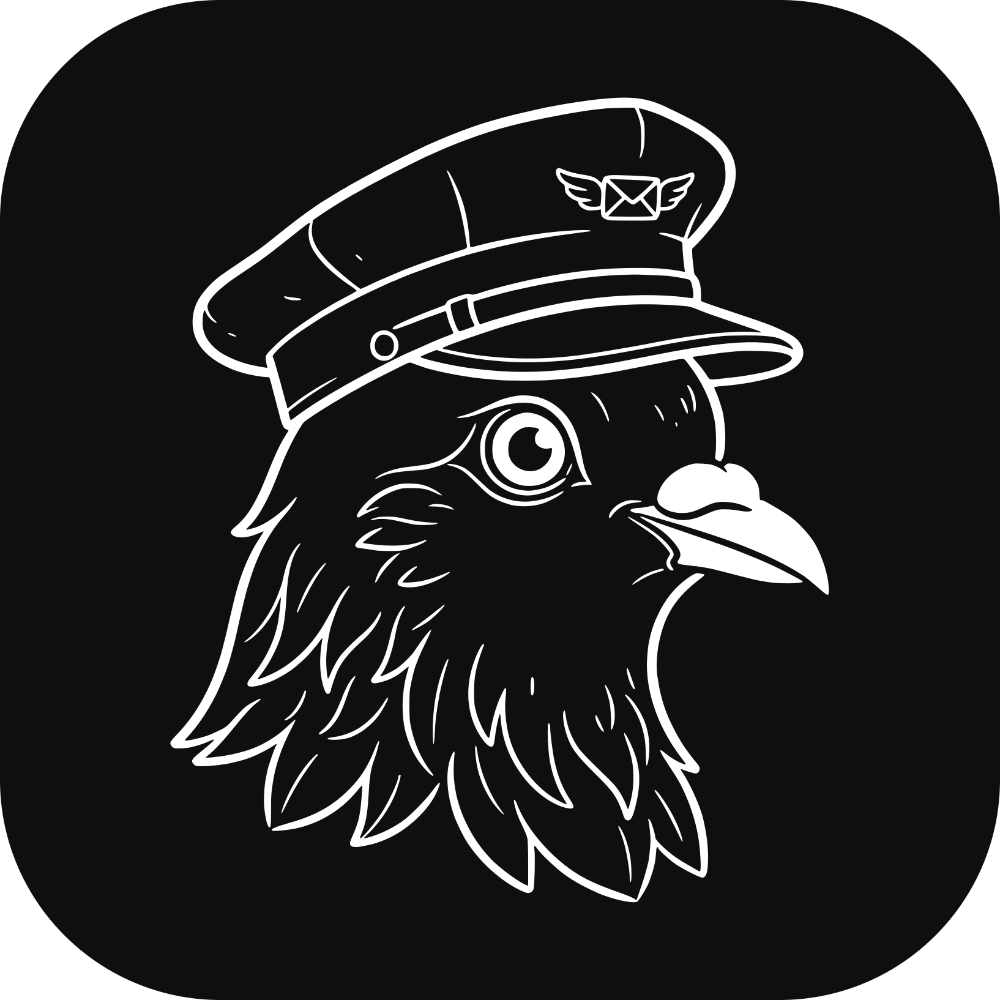

# Robin

**Website:** https://robin.ravenburst.com · **Download:** [Robin-Portable.exe](https://github.com/matpitts13/flockton-robin/releases/latest/download/Robin-Portable.exe) (or the [installer](https://github.com/matpitts13/flockton-robin/releases/latest/download/Robin-Setup.exe))

A free Windows app for thank-you stickers and package insert cards. Part of [Flockton](https://flock-ton.ravenburst.com), free tools for small online sellers.

Pick a shape and size, start from a ready-made design or bring your own art, and Robin fills the sheet. Print on full-sheet sticker paper, pre-cut sticker sheets or cardstock, save a print-ready PDF, or export a picture for a Cricut.

## Use it

1. **Shape and size:** circles (1.5, 2, 2.5, 3 in), squares (1.5, 2, 3 in), rectangles (3 × 2, 4 × 2 in) and cards (3.5 × 2, 4 × 6, 4.25 × 5.5, 5 × 7 in). Squares and rectangles can have rounded corners.
2. **Design:** start from one of ten thank-you designs, then change the words, shop name, font, colours, border and decoration.
3. **Your art (optional):** add a logo (it sits above the words) or a finished design (it fills the whole sticker). PNG, JPG, WebP or SVG. You can drop it onto the window.
4. **Print on:**
   - *Plain paper, cardstock or full-sheet sticker paper:* Robin fits as many as it can, turning them sideways if that fits more, with crop marks in the margin for a paper trimmer.
   - *Pre-cut sticker sheet:* type in your sheet's columns, rows, margins and spacing (from the pack or the maker's template).
5. Click **Print** (Ctrl+P) and keep the scale at **100% / Actual size**, or **Save PDF** (Ctrl+S).

**Printer adjustment:** if everything lands a little off, move it right or down in small steps. Print a test on plain paper and hold it against your sticker sheet.

**Cut outline:** a thin line on the cut edge, for scissors or a punch.

**Bleed:** each design prints 1/16 in past its cut line, so a slightly-off cut never shows a white edge.

### Cricut

**Export for Cricut** saves one 300 dpi PNG of the design with a transparent background. In Cricut Design Space, upload it as a Print Then Cut image, set its width to the sticker size, and set how many you want. Design Space adds its own registration marks.

### Make your own design

**Design template** saves a blank SVG artboard for the size you picked (red: bleed edge, black: cut line, blue dashed: safe zone). Design on it in Canva, Inkscape, Affinity or Illustrator, hide the guides, export a PNG at the pixel size printed on the template, then add it under **Your art** and choose **Fill the whole sticker**.

## Run from source

Needs Node.js 22 or newer.

```
npm install
npm start           # run the app
npm test            # unit tests
npm run smoke       # walk through sample designs; fail on any console error; write .smoke/ screenshots and PDFs
npm run smoke -- art.png   # also try a picture as "your art"
npm run dist        # build the Windows installer and portable .exe into dist/
```

## Privacy

Everything happens on your computer. The app has no network access, no accounts and no analytics. It reads only the pictures you give it and writes only the files you save.

## License

MIT. Fonts: Dancing Script, DM Serif Display, Fredoka and IBM Plex Sans, all under the SIL Open Font License (see `src/renderer/fonts`). Not affiliated with Cricut, Avery or any marketplace.
